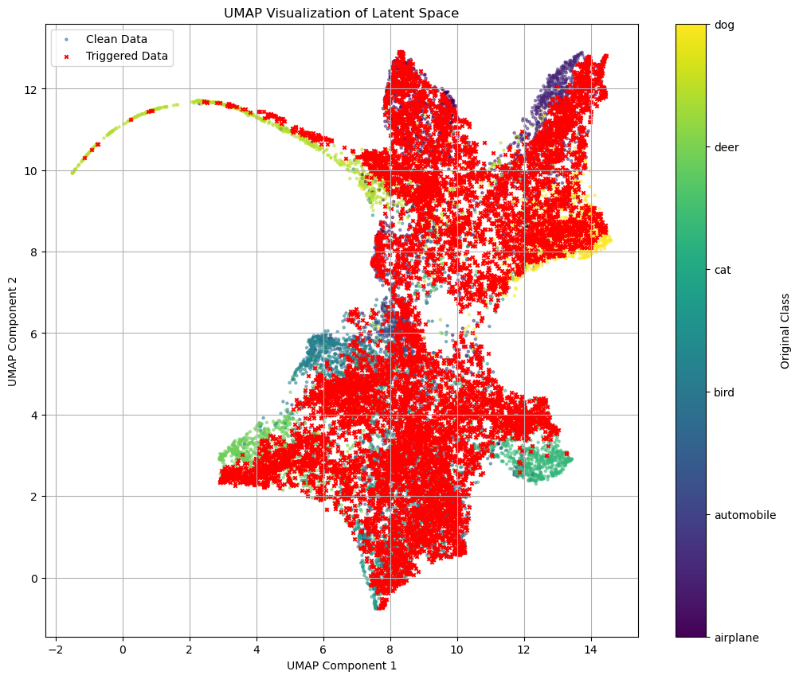
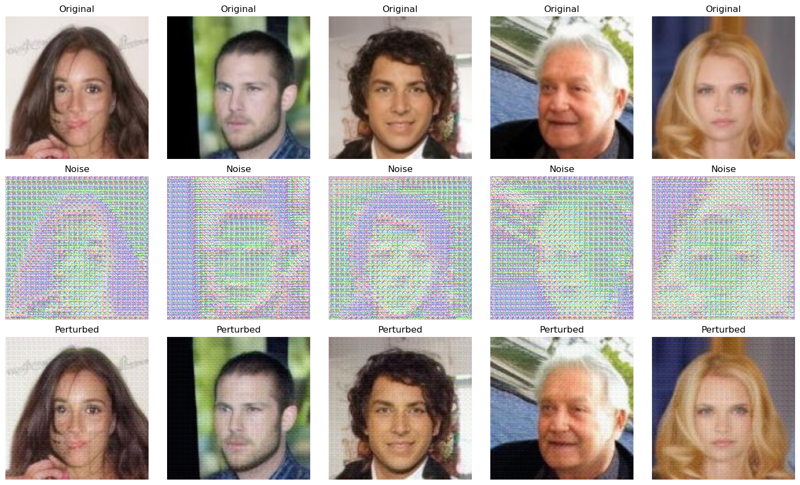
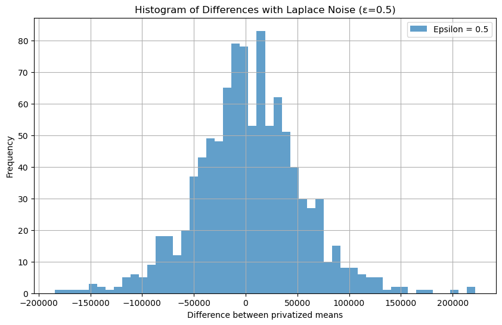
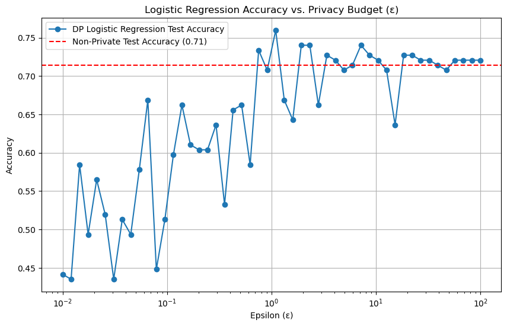
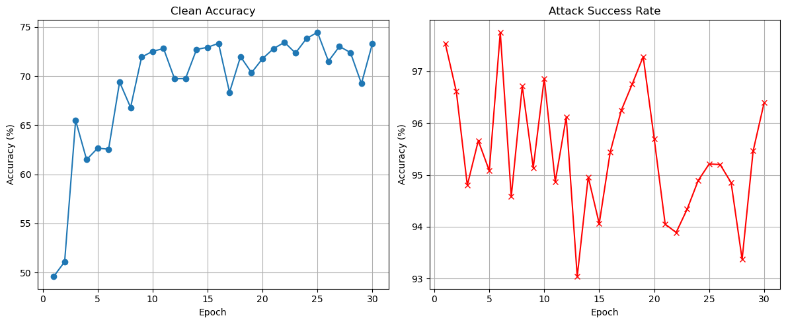

# Fairness, privacy and backdoor defences

Three trustworthy-ML experiments on a shared codebase: an ε-bounded
perturbation that removes gender bias from a frozen CelebA smile classifier
without touching its weights; differential privacy applied to a statistic, to a
fitted model and inside a training loop; and a CIFAR-10 backdoor attack with a
distillation defence against it.

The headline result is the third. The defence reported reducing the attack
success rate from 96% to 11% — and it did not, because the trigger it probed
with was not the trigger the model was poisoned with. The attack writes a solid
white 3×3 patch into the bottom-right corner; the defence's evaluation writes a
3×3 checkerboard into the top-right. The two are defined thirty cells apart, by
hand, in a single notebook. On top of that, the success rate divided by the
whole test set, whose 1,000 genuine airplanes gave the metric a floor of about
10% for any model at all — so 11% is what an *untrained* network scores. The
defence may well work. The experiment did not find out.

Here every trigger is one `Trigger` object, used for poisoning and for probing,
and attack success rate excludes the target class. Notebook 04 prints the
original measurement next to the corrected one so the gap is visible rather
than argued.

<p align="center"><br><em>UMAP of the poisoned ResNet-18's penultimate features. Clean test images fall into the usual ten clusters; triggered images collapse into one, sitting with the airplanes, whatever class they came from.</em></p>

## Notebooks

| notebook | what it does |
|---|---|
| [01_faap_fairness.ipynb](01_faap_fairness.ipynb) | biased CelebA smile classifier, then FAAP: a generator vs a latent gender discriminator, with fairness metrics and t-SNE before and after |
| [02_differential_privacy.ipynb](02_differential_privacy.ipynb) | Laplace and Gaussian mechanisms on a mean, output perturbation on a regression, and `diffprivlib` logistic regression and Gaussian naive Bayes across 50 budgets |
| [03_backdoor_attack.ipynb](03_backdoor_attack.ipynb) | 10% poisoning with a corner patch, target class *airplane*, plus UMAP of where the backdoor lives |
| [04_backdoor_defence.ipynb](04_backdoor_defence.ipynb) | teacher–student distillation with adaptive layer-wise re-initialisation, cross-entropy vs KL |

[`trustlab.py`](trustlab.py) holds everything shared: the trigger, the metrics,
the mechanisms, the models, the plotting. Each helper that fixes something
carries a docstring saying what the original did and why it was wrong.

The Persian report that accompanied the original work is translated in full at
[docs/report.md](docs/report.md), with a note inserted at each point where it
and the code disagree.

## Model and data

| | |
|---|---|
| **fairness** | CelebA (`tpremoli/CelebA-attrs-160k-artificial`), 224×224, ResNet-18 from scratch, label *Smiling*, protected attribute *Male* |
| **privacy** | five synthetic salaries; 100-point synthetic linear regression; Pima diabetes; iris |
| **backdoor** | CIFAR-10, ResNet-18 from scratch, 10% poisoned, target class *airplane* |

## Fairness

The classifier is trained on a slice in which 45% of the images are smiling
women and 15% are smiling men. It learns gender as a shortcut for smiling, and
its positive-prediction rate splits by 9.3 points between the groups.

FAAP leaves that model alone. A generator produces an image-dependent
perturbation bounded by ε; a discriminator tries to read gender out of the
frozen classifier's 512-d features of the perturbed image; the generator wants
that discriminator at chance while the smile logits stay correct.

<p align="center"><br><em>Images produced by the generator. ε = 0.10 in [−1, 1] units, which is 12.75/255 in pixel terms — large by the standards of adversarial robustness, where 8/255 is the usual ceiling, and never stated in those units in the original.</em></p>

| metric | before FAAP | after FAAP | change |
|---|---|---|---|
| accuracy | 0.886 | 0.903 | +1.7% |
| DP difference | 0.093 | 0.068 | −26.9% |
| EO difference | 0.070 | 0.042 | −40.0% |

Both rows use the same untouched classifier; only the input differs, which is
the whole claim FAAP makes.

Two things make these numbers less conclusive than they look. Accuracy rising
under an adversarial perturbation is possible — the task loss is in the
generator's objective with weight 1.0, so the perturbation can act as a learned
input-space correction — but it is also the shape of a measurement error.
And the metric that would settle it was measured wrong: the original logged a
*training* fooling accuracy, read off the same batch the discriminator had just
been updated on, and that number **fell** from 42.07% to 35.75% over the ten
epochs. The discriminator was winning. If gender is still in the features, a
fairness gain of this size is as easily explained by a shifted threshold as by
the mechanism. Notebook 01 measures leakage on held-out data instead.

## Privacy

<p align="center"><br><em>1,000 differentially private releases of a difference between two means. The true difference is 50; the standard deviation of a single release is about 47,000.</em></p>

The thread through all three exercises is that **noise is not error**. Laplace
and Gaussian are unbiased mechanisms, so averaging enough releases recovers the
true answer; what privacy costs is variance. The original printed the mean of
1,000 noisy differences — 3,742.80 against a true 50 — without noting that at
1,000 draws the standard error is around 1,500, so that number is the sampling
error of the experiment rather than a property of the mechanism.

| exercise | original | here |
|---|---|---|
| Laplace on a mean | 1,000 draws, one sensitivity for both queries | 200,000 draws with a reported standard error; `(hi−lo)/n` derived per query |
| ε sweep | 1,000 draws per ε | 50,000 draws per ε |
| private regression | one noise draw per ε | 500 draws per ε with error bars |
| `diffprivlib` | one fit per ε, bounds inferred, 50 `PrivacyLeakWarning`s | 20 fits per ε, explicit public bounds, warnings escalated to errors |

<p align="center"><br><em>DP logistic regression across 50 budgets, one fit each. Below ε ≈ 0.1 the curve swings between 0.44 and 0.65 — not a trend, a single sample per point, from a model that has learnt nothing.</em></p>

The bounds point is the one that changes what ε *means*. `diffprivlib` will
infer feature bounds from the data if you do not supply them, and warns that it
is doing so; the bounds are then themselves a function of the private data, and
the true privacy cost exceeds the ε you asked for. Supplying bounds from public
knowledge of the feature domain — clipping to ±3 standard deviations, or the
documented measurement range for iris — is what makes the stated budget real.

## Backdoor

<p align="center"><br><em>The poisoned model: clean accuracy tracks a normally-trained network while the attack success rate climbs past 95%.</em></p>

| model | clean accuracy | attack success rate |
|---|---|---|
| poisoned teacher | 73.33% | 96.39% ⚠ |
| distilled student, cross-entropy | 72.96% | 11.03% ⚠ |
| distilled student, KL divergence | 73.19% | 12.39% ⚠ |

⚠ All three ASRs were computed over the whole 10,000-image test set, which
contains 1,000 genuine airplanes; those are classified correctly and counted as
successes. Excluding them moves the teacher to ≈95.99% — a small correction, on
a strong attack — and removes the floor that the two student rows are sitting
on. The students' figures were additionally measured against the wrong trigger.
The numbers are left in the table as reported, because they are what the run
produced.

The evidence that the students' ASR means nothing is in the training log: the
cross-entropy student reported 11.07% at **epoch 1**, when its clean accuracy
was 49.32% and it had barely learnt to classify at all. It "converged" to
11.03%. A metric that starts at its final value before the method has done
anything is not measuring the method.

Notebook 04 ends by printing all three measurements — correct trigger with the
target class excluded, correct trigger over the whole test set, and the
original's checkerboard over the whole test set — for both students and for a
freshly initialised network as a reference.

## What was corrected

The original was a single 33-cell notebook with a 17-page report. Fixing it
meant separating three different kinds of problem: results that are wrong,
results that are right but not comparable, and code that works but should not
be copied. Everything in the first two groups is documented rather than quietly
changed, so the numbers in the tables above stay traceable to the run that
produced them.

**Wrong measurements**

1. **Three trigger definitions for one backdoor.** Poisoning writes
   `img[-3:, -3:, :] = 255` (bottom-right, solid); the attack's evaluation
   writes `[:, :, -3:, -3:] = 1.0` (consistent); the defence writes a 3×3
   checkerboard at `[:, :, :3, -3:]` (top-right). The defence therefore probes
   a pattern the model was never taught. One `Trigger` object now does all
   three jobs.
2. **ASR counts the target class.** Dividing by the whole test set counts the
   1,000 real airplanes as attack successes, giving every model a ~10% floor.
   `evaluate_backdoor` divides by the non-target images only and reports `n`.
3. **Fooling accuracy was a training metric**, read off the same batch the
   discriminator had just been updated on — and it declined over training,
   while the report described the metrics as "constant and at an acceptable
   level". Replaced with held-out attribute leakage.
4. **`np.mean` of 1,000 Laplace draws** reported as a result (3,742.80 against
   a true 50) when the standard error at that sample size is ~1,500.
5. **One noise draw per ε** in the private regression, which is why the MSE
   curve is non-monotone at ε = 1.0. The report attributes this to random
   sampling, correctly, and then leaves it. Averaging fixes it.
6. **`diffprivlib` bounds inferred from the data**, raising
   `PrivacyLeakWarning` on all 50 fits — the reported ε is not the true privacy
   cost. Explicit public bounds; warnings are now errors.
7. **One mean-sensitivity for two differently-sized queries.** The report's own
   table lists 10,400 for the five-record mean and 13,000 for the four-record
   one; the code uses 13,000 for both, over-noising the first by 25%. Neither
   was derived. `mean_sensitivity(n, lo, hi)` derives it.
8. **The Gaussian-mechanism formula outside its validity range.**
   `σ = √(2 ln(1.25/δ))·Δ/ε` requires ε ≤ 1; the sweep runs to ε = 5. Still
   swept, now labelled.
9. **`sensitivity = 0.05` on regression coefficients**, asserted with no
   derivation. Output perturbation on unconstrained least squares has no finite
   sensitivity; now marked as a stipulation for the exercise rather than a
   result.

**Broken or fragile code**

10. **`torch.clamp(tanh_output, -ε, ε)` in the generator.** `clamp` has zero
    gradient outside its range, so every saturated element stops learning
    silently. `eps * torch.tanh(...)` is bounded by construction and
    differentiable everywhere.
11. **`loss_G_fair = -CE(...)`.** Minimising a negated cross-entropy is
    unbounded below and is satisfied by making the discriminator *confidently
    wrong* — which preserves gender information in flipped form. Cross-entropy
    against a uniform target is bounded by `log(num_classes)` and is minimised
    exactly at chance.
12. **`random.seed(SEED)` only**, in three separate cells. That seeds the
    stdlib RNG, which none of the NumPy or PyTorch sampling goes through.
    `set_seed` covers all four.
13. **`TSNE(n_iter=300)`.** `n_iter` was renamed `max_iter` in scikit-learn 1.5
    and removed in 1.7, so the cell no longer runs; and 300 is well under the
    default 1,000, leaving the embedding unconverged.
14. **A fresh `SmileClassifier()` instantiated over the trained one**, three
    cells after training it. Only a later `load_state_dict` rescued the run.
15. **`poison_dataset` mutates `dataset.data` in place** and is unseeded, so
    re-running the cell compounds the poisoning with a different index set each
    time. It also spends part of the 10% budget on images already in the target
    class, which need no flip — the effective rate is ≈9%. Now seeded,
    non-mutating, and drawn from non-target images only.
16. **Generator and discriminator left in `train()` mode** during evaluation,
    so the generator's BatchNorm statistics kept drifting and its eval-time
    behaviour differed from training — a problem for a perturbation that is
    meant to be deployed.
17. **`plt.colorbar(...).set_yticklabels(classes + ['Triggered'])`** — eleven
    labels on a ten-tick colourbar, which silently mislabels every class.
    Replaced with a discrete legend.
18. **`KMP_DUPLICATE_LIB_OK = TRUE`**, which suppresses an OpenMP runtime
    conflict rather than resolving it. Removed.
19. **`diabetes.csv.csv`** — a double extension, from a file saved by a browser.
20. Two forward passes through the frozen ResNet per FAAP batch where one
    suffices; torch, NumPy and matplotlib re-imported in eight cells; Persian
    section headings; no class names on any CIFAR-10 figure.

**Presentation**

21. The 33 cells are split into four notebooks along the three questions, with
    the shared code factored into `trustlab.py`, so the backdoor defence can be
    run against the attack's artefacts instead of redefining them.
22. ε stated in pixel units wherever it appears, not only in normalised ones.
23. A majority-class baseline drawn on every accuracy-vs-ε plot, which is what
    makes the low-budget end of those curves readable.

## Where the report and the code disagree

| | report | notebook |
|---|---|---|
| base classifier accuracy | ≈89% | 90.10% (eval cell), 0.886 (fairness cell) |
| FAAP split composition | 668 / 1252 / 979 / 1101 | 633 / 1008 / 1247 / 1112 |
| test split composition | 356 / 623 / 475 / 546 | 336 / 614 / 530 / 520 |
| non-private logistic regression | 0.7416 | 0.7143 |
| non-private GaussianNB | 0.96 | 1.0000 |
| re-initialisation rates δ_l | 0.01 shallow / 0.27 deep (the paper's) | 0.1 / 0.5 / 0.8 |
| FAAP training metrics | "constant and at an acceptable level" | fooling accuracy falls 42.07% → 35.75% |
| mean sensitivity | 10,400 and 13,000, correctly distinguished | 13,000 for both |
| distillation | "both methods reduced ASR to an acceptable range" | measured against a trigger no model was trained on |

The three-value spread on the base accuracy, and the two split tables that each
sum correctly to their totals but disagree with the notebook, are the same
phenomenon: the cells were not run in one pass. The report says so itself, on
page 3 — *"at the time I am writing this report this number was obtained; I
have probably re-run the code later for confirmation and the results have
changed slightly."* That disclosure is preserved in the translation.

## Running it

```bash
pip install -r requirements.txt
```

Then run the notebooks in order — 03 saves `poisoned_resnet18.pth`, which 04
loads as its teacher.

Data locations are read from the environment. All three are optional; each
falls back to a path under `data/`, and CelebA and CIFAR-10 download themselves
on first use.

| variable | default | what it points at |
|---|---|---|
| `CELEBA_DATA_DIR` | `data` | Hugging Face cache for the CelebA attributes dataset |
| `CIFAR10_DATA_DIR` | `data` | torchvision CIFAR-10 root |
| `DIABETES_CSV` | `data/diabetes.csv` | the Pima diabetes CSV |

There is no `.env` file in this repository and none is read. Set the variables
in your shell if the defaults do not suit:

```bash
export CIFAR10_DATA_DIR=/mnt/datasets/cifar10
```

PowerShell:

```bash
$env:CIFAR10_DATA_DIR = "D:\datasets\cifar10"
```

A GPU is assumed but not required; `trustlab.DEVICE` falls back to CPU. The
CelebA notebook at 224×224 is the expensive one.

## References

- Wang, Z. et al. *Fairness-aware Adversarial Perturbation Towards Bias
  Mitigation for Deployed Deep Models.* CVPR 2022.
- Dwork, C. and Roth, A. *The Algorithmic Foundations of Differential Privacy.*
  Foundations and Trends in Theoretical Computer Science, 2014.
- Holohan, N. et al. *Diffprivlib: The IBM Differential Privacy Library.* 2019.
- Gu, T. et al. *BadNets: Identifying Vulnerabilities in the Machine Learning
  Model Supply Chain.* 2017.
- Hinton, G., Vinyals, O. and Dean, J. *Distilling the Knowledge in a Neural
  Network.* NIPS Deep Learning Workshop, 2015.
- Li, Y. et al. *Neural Attention Distillation: Erasing Backdoor Triggers from
  Deep Neural Networks.* ICLR 2021.

## Licence

[MIT](LICENSE).

## Contributors

- Alireza Shiri (@AlirezaShG)
