# Report

*Translated from the original Persian submission. The text is the author's;
the translation keeps its structure, its numbers and its conclusions, including
the ones the code does not support. Where the report and the notebooks
disagree, or where a conclusion does not follow from what was measured, a note
is inserted rather than the text being altered — the disagreements are part of
what this repository documents. A consolidated list is in the README under
"What was corrected" and "Where the report and the code disagree".*

---

## Question 1 — Fairness adversarial perturbation

### The idea of the paper

The general idea of the paper is this: the base model is biased on a secondary
attribute such as gender when it assigns its labels — for example, it labels
men as smiling more often than women, on account of face shape, when the task
is smile detection. To remove that bias without modifying the base model, we
use a GAN generator. The generator must produce images that both carry out the
main task correctly (the correct label is still predicted) and fool the
discriminator whose job is to say whether the image is of a woman or a man
(or any other secondary attribute). We obtain these images and then feed them
to the model. **The strength of this idea is that we no longer need to modify
the base model — it is enough to change the input.**

### Preparing and splitting the data

First we display a few images from the dataset. The dataset is structured as a
dictionary whose keys are the original images and the labels (smiling, male,
and so on), belonging to various celebrities. The images were chosen at random
with random seed 42. Following the requested grouping, the data were split as
follows.

**Figure 1: a few images with their labels shown.**
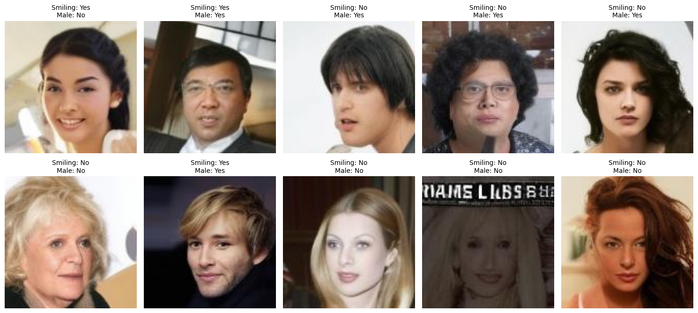

**Table 2: Biased Classifier Train Set (N = 4000)**

| gender | smiling | count | percentage |
|---|---|---|---|
| Male | Yes | 600 | 15.00 |
| Female | Yes | 1800 | 45.00 |
| Male | No | 800 | 20.00 |
| Female | No | 800 | 20.00 |

**Table 3: FAAP (GAN) Set (N = 4000)**

| gender | smiling | count | percentage |
|---|---|---|---|
| Male | Yes | 668 | 16.70 |
| Female | Yes | 1252 | 31.30 |
| Male | No | 979 | 24.47 |
| Female | No | 1101 | 27.52 |

**Table 4: Test Set (N = 2000)**

| gender | smiling | count | percentage |
|---|---|---|---|
| Male | Yes | 356 | 17.80 |
| Female | Yes | 623 | 31.15 |
| Male | No | 475 | 23.75 |
| Female | No | 546 | 27.30 |

> **Note.** The notebook run that produced the saved outputs gives different
> counts for the second and third tables — 633 / 1008 / 1247 / 1112 and
> 336 / 614 / 530 / 520. Each set sums correctly to 4000 and 2000, so these are
> two different draws rather than an arithmetic error; only the first table,
> whose quotas are fixed by hand, is stable across runs.

### Training the base model

**Figure 2: accuracy and loss of the base model.**
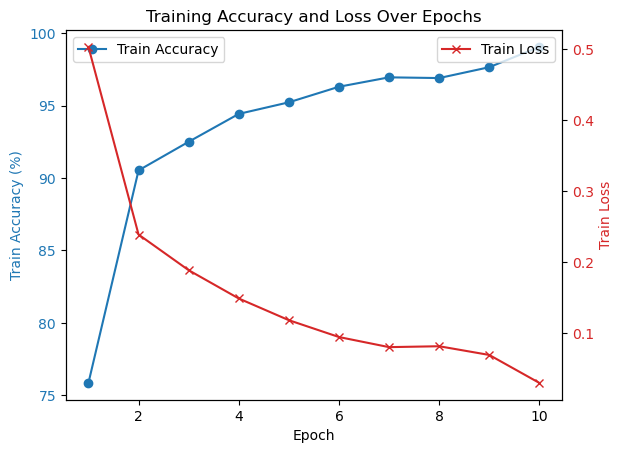

Here we train a ResNet-18 that has not been pre-trained, on this data and on
the `Smiling` label, so that it learns to detect a smile. I used the suggested
hyperparameters. Accuracy on the test data came out at about **89%**.

> **Note.** The author's own disclaimer, which follows in the original, is
> worth keeping. The same quantity appears three times across the submission
> with three values — ≈89% here, 90.10% in the notebook's evaluation cell, and
> 0.886 in the fairness-metrics cell — which is direct evidence that the cells
> were not all run in a single pass.

**A note.** *This number was obtained at the time I am writing this report; I
have probably re-run the code later for confirmation, and the results have
changed slightly.*

### Designing and implementing FAAP

**Figure 3: images generated by the GAN.**
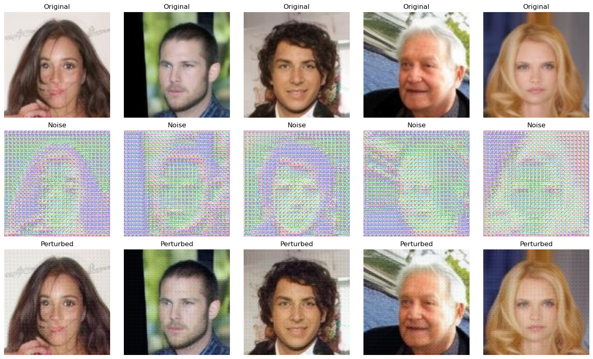

**Figure 4: the GAN's training curves.**
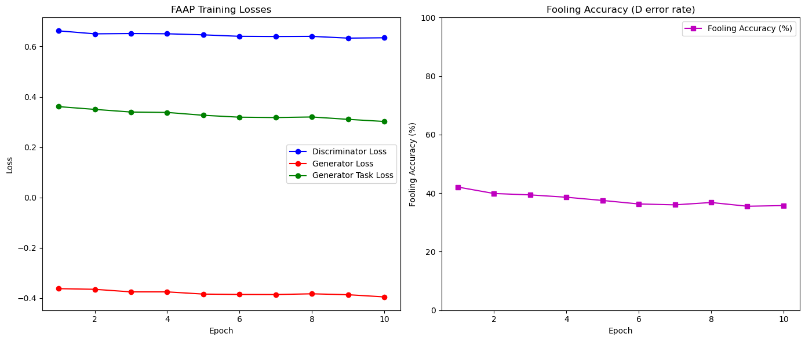

Throughout training almost all the metrics are constant and at a level
acceptable to us, because the base model does not have much discrimination (as
was observed when the metrics were examined). This is a consequence of the
choice of the parameters α and β, which here are 0.1 for alpha and 1.0 for
beta. The effect of decreasing and increasing these parameters is as follows,
and we will see below that with this choice the model's accuracy improved and
its discrimination also decreased.

**The effect of α and β.**

- **Decreasing α:** removal of gender information becomes weaker (more
  discrimination remains), but smile-detection accuracy is better preserved.
- **Increasing α:** removal of gender information becomes stronger (less
  discrimination), but smile-detection accuracy may drop.
- **Decreasing β:** less focus on preserving smile accuracy (accuracy may fall),
  but gender removal is done better.
- **Increasing β:** more focus on preserving smile accuracy (accuracy rises),
  but gender removal becomes weaker (discrimination may remain).

> **Note.** The metrics are not in fact constant. The fooling accuracy logged
> over the ten epochs falls monotonically from 42.07% to 35.75% — the
> discriminator is winning, which is the opposite of what the generator is
> being trained to achieve. It is also a *training* metric, read off the same
> batch the discriminator had just been updated on, so it cannot support a
> claim about the perturbation's effect in the first place. Notebook 01
> replaces it with held-out leakage measured on the test split.

### Evaluating and analysing the FAAP model

**The metric formulas.**

**Demographic Parity (DP diff):**

    DP diff = | P(Ŷ = 1 | A = 0) − P(Ŷ = 1 | A = 1) |

This measures the difference in the positive-prediction rate between the
protected groups (for example, women and men). The ideal value is **0**. The
metric asks whether the model predicts "smiling" equally often for the
different groups.

**Equal Opportunity (EO diff):**

    EO diff = | P(Ŷ = 1 | Y = 1, A = 0) − P(Ŷ = 1 | Y = 1, A = 1) |

This measures the difference in the rate of correctly detecting positives
between the protected groups. The ideal value is **0**. The metric asks
whether, when a person really is smiling, the model detects that smile equally
well for women and for men.

**Table 5: model performance before and after applying FAAP**

| metric | before FAAP | after FAAP | change (%) |
|---|---|---|---|
| Accuracy | 0.886 | 0.903 | +1.7 |
| DP diff | 0.093 | 0.068 | −26.9 |
| EO diff | 0.070 | 0.042 | −40.0 |

**Interpreting the results.**

*Accuracy.* The model's accuracy rose from 88.6% to 90.3% (+1.7%). This unusual
improvement is due to the choice of suitable alpha and beta parameters. Alpha
was set below 1 — indicating that discrimination matters less and model
accuracy matters more — while beta was set to 1, which can be read as treating
the absence of discrimination and the model's accuracy as equally important.
The FAAP perturbations acted as a regularisation mechanism and reduced the
model's dependence on irrelevant features.

*DP diff.* The demographic-parity difference fell from 0.093 to 0.068 (−26.9%).
This reduction indicates that the smile-prediction rate has become more
balanced between the protected groups. The base model had a 9.3% difference in
smile prediction between the groups; FAAP reduced it to 6.8%.

*EO diff.* The equal-opportunity difference fell from 0.070 to 0.042 (−40.0%).
This substantial improvement shows that the ability to correctly detect a smile
has become more balanced across the groups. The base model performed worse at
detecting smiles for one group (probably the minority group); FAAP reduced that
difference to 4.2%.

With a 26.9% improvement in DP diff and 40.0% in EO diff, FAAP reduced
discrimination considerably while also raising accuracy by 1.7%. These results
show that FAAP can improve the utility and the fairness of machine-learning
models at the same time, especially when the base model depends heavily on the
protected attributes.

> **Note.** An accuracy increase under an adversarial perturbation is possible
> — β = 1.0 puts the task loss directly in the generator's objective — but it
> is also the signature of a measurement problem, and it needs the leakage
> curve beside it to be interpretable. If gender information is still present
> in the features, a fairness gain of this size is as easily explained by a
> shifted decision threshold as by the mechanism the method claims.

### t-SNE

**Figure 5: t-SNE before and after the FAAP algorithm.**
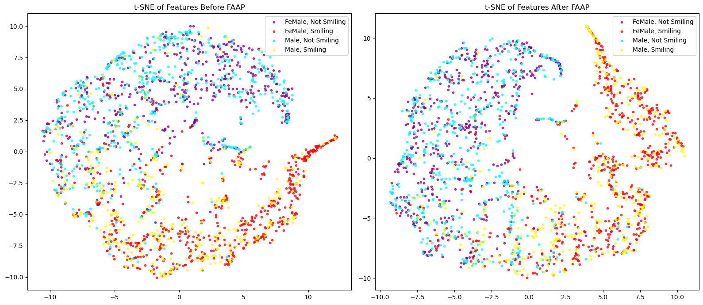

The t-SNE results bear witness that the FAAP algorithm has caused the Smiling
and not-Smiling classes to separate from one another in this space, without
regard to gender. Before running this algorithm the separation was smaller and
the model paid more attention to gender; after running FAAP, this shows the
method was successful. The model did, of course, have only a little bias before
the algorithm was run.

> **Note.** The embedding was computed with `n_iter=300`. scikit-learn's
> default is 1000, and 300 typically stops before the layout has converged, so
> apparent cluster separation at that setting is not reliable evidence of
> anything. (`n_iter` was also renamed `max_iter` in scikit-learn 1.5 and
> removed in 1.7, so the cell as written no longer runs on a current install.)

---

## Question 2 — Differential privacy

### Part one, subsection one

**Figure 6: distribution of the difference of means under Laplace noise.**
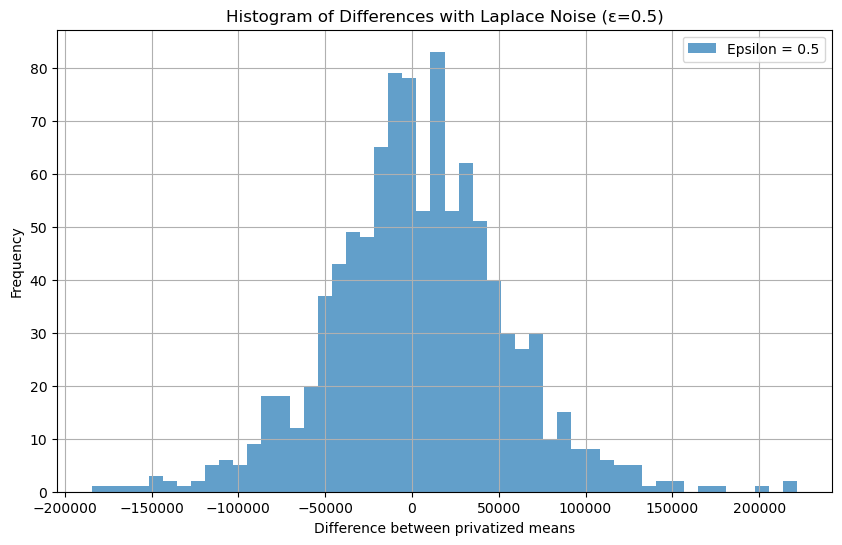

| parameter | value |
|---|---|
| mean with the first person | 49,800 |
| mean without the first person | 49,750 |
| true difference | 50 |
| sensitivity (with the person) | 10,400 |
| sensitivity (without the person) | 13,000 |
| Laplace noise scale | 26,000 |

**Reading the histogram.** The distribution is roughly symmetric about zero
with a range of ±200,000. The main mass is seen within ±100,000. The heavy
tails of the Laplace distribution give a high probability of large differences.
The true difference (50) is lost in the noise, which indicates strong privacy.

> **Note.** The table gives two sensitivities, 10,400 and 13,000, correctly
> reflecting that a mean over five records is less sensitive than a mean over
> four. The code uses 13,000 for both, which over-noises the first query by
> 25%. Neither figure is derived in the report; both follow from the bounded-DP
> rule `(hi − lo)/n` with `hi = 52,000` and `lo = 0`.
>
> Separately: the printed mean of the 1,000 simulated differences is 3,742.80,
> and the report does not comment on it. The Laplace mechanism is unbiased, so
> that average should converge to 50. With only 1,000 draws at a per-draw
> standard deviation near 47,000, the standard error is about 1,500 — so 3,743
> is an unremarkable sample mean and says nothing about the mechanism.
> Notebook 02 runs 200,000 draws and reports the standard error alongside it.

### Part one, subsection two

**Figure 7: distribution of the difference of means under Laplace noise at
different values of epsilon.**
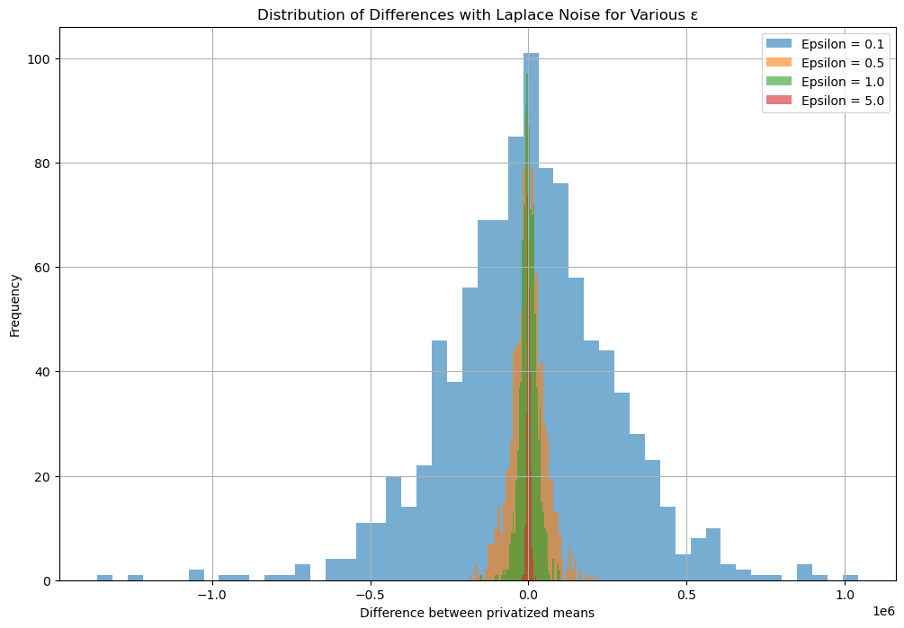

| ε | noise scale | spread of the difference | accuracy |
|---|---|---|---|
| 0.1 | 130,000 | ±200,000+ | very low |
| 0.5 | 26,000 | ±150,000 | low |
| 1.0 | 13,000 | ±100,000 | medium |
| 5.0 | 2,600 | ±20,000 | high |

**Reading the histogram.** Decreasing ε increases the noise and reduces the
concentration of the distribution. At ε = 0.1 the distribution is entirely
broad and flat, which indicates strong privacy. At ε = 5.0 it is narrow with a
sharp peak, which indicates high accuracy. The inverse relation between privacy
and accuracy is clearly visible.

### Part one, subsection three

**Figure 8: distribution of the difference of means under Gaussian noise at
different values of epsilon.**
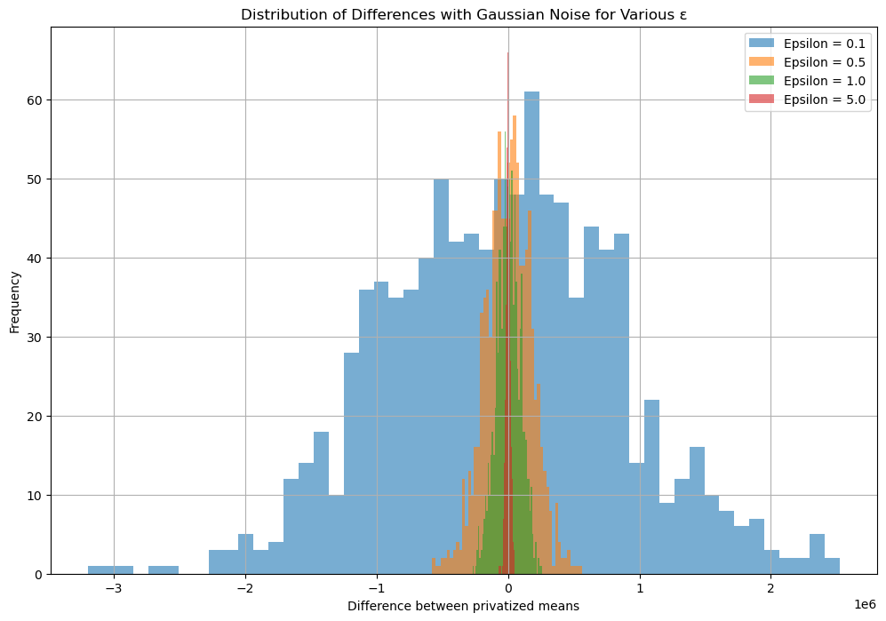

| ε | Gaussian noise scale | compared with Laplace |
|---|---|---|
| 0.1 | ≈629,200 | wider |
| 0.5 | ≈125,840 | wider |
| 1.0 | ≈62,920 | wider |
| 5.0 | ≈12,584 | wider |

**Reading the histogram.** Gaussian noise at the same ε is larger than Laplace.
The wider tails of the Gaussian distribution make very large differences more
probable. At every ε the Gaussian behaviour is wider than the Laplace. The
Gaussian mechanism is more suitable for stronger privacy (especially at small
ε).

> **Note.** The classical Gaussian-mechanism calibration
> `σ = √(2 ln(1.25/δ)) · Δ/ε` is only valid for ε ≤ 1, so the last two rows of
> this table describe noise that carries no (ε, δ) guarantee. The reason the
> Gaussian is wider here is that the query is one-dimensional; the Gaussian
> mechanism's advantage appears on high-dimensional queries, where L2
> sensitivity grows as √k rather than k.

### Part two

**Figure 9: model error as privacy increases.**
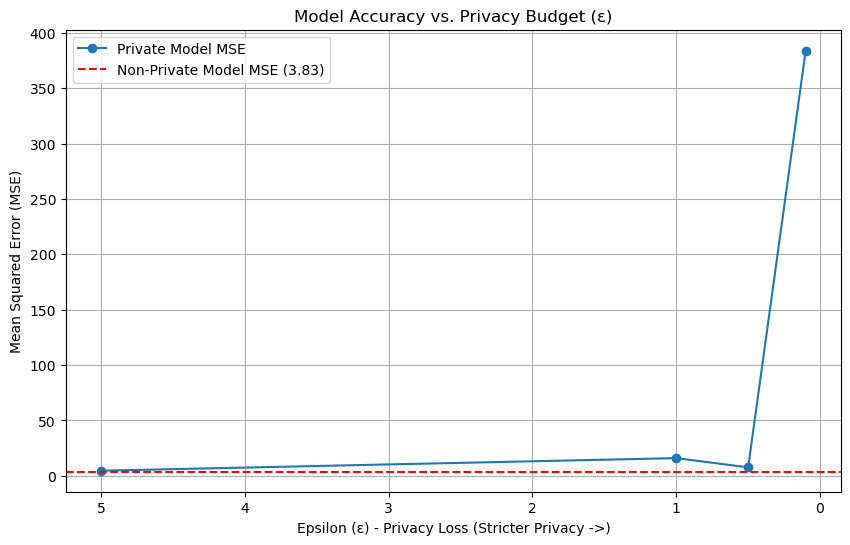

**The non-private baseline model.** The non-private model's weights,
`[1.969612, −3.44497464]`, are very close to the true values `[2.0, −3.5]`. The
mean squared error (MSE) on the test data is 3.7502, which indicates acceptable
model accuracy in the noiseless case.

**The effect of privacy on model performance.** The table below shows the
private model's results at different values of ε.

| ε | MSE | increase over the baseline (%) |
|---|---|---|
| 0.1 | 383.7725 | 10126 |
| 0.5 | 7.6002 | 103 |
| 1.0 | 15.9279 | 325 |
| 5.0 | 4.5578 | 22 |
| no noise | 3.7502 | 0 |

**Analysis.** Decreasing ε (increasing privacy) generally increases the MSE. At
ε = 0.1 the MSE reaches 383.7725, which indicates severe corruption of the
weights and a useless model. At ε = 5.0 the MSE is only 22% above the baseline,
which indicates acceptable preservation of accuracy.

An unexpected result is seen at ε = 1.0, with an MSE of 15.9279 — higher even
than at ε = 0.5. This anomaly is probably caused by random sampling. In general,
as privacy increases the model's accuracy decreases and the model's weights are
rendered worthless and devoid of useful information.

> **Note.** The diagnosis is right and the fix is one line: each ε here is a
> single noise draw, so the curve is a sample path rather than the mechanism's
> behaviour. Notebook 02 averages 500 draws per ε and plots the standard error,
> at which point the curve is monotone. The sensitivity of 0.05 used for the
> regression coefficients is also asserted rather than derived — output
> perturbation on unconstrained least squares has no finite sensitivity without
> bounds on the design matrix, so the number is a stipulation for the sake of
> the exercise.

### Part three

**Figure 10: privacy against model accuracy — test.**
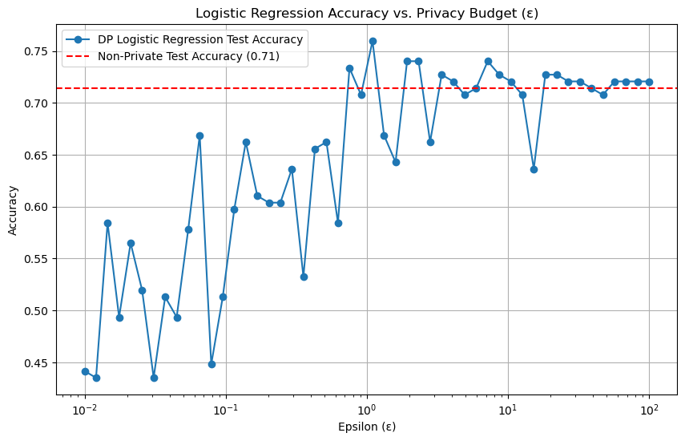

**Figure 11: privacy against model accuracy — train.**
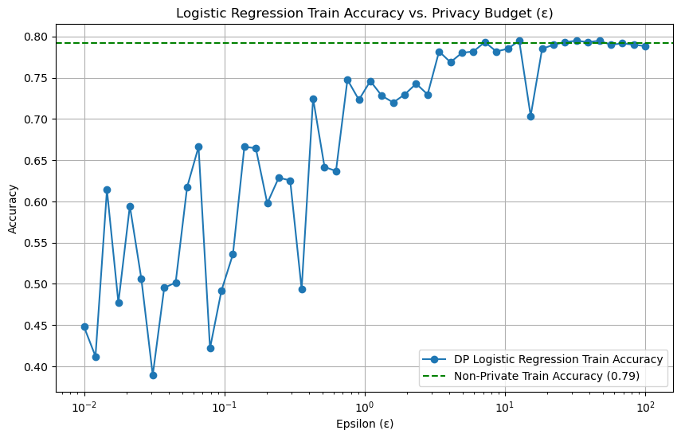

**Subsection one: the baseline logistic-regression model (diabetes dataset).**
The non-private logistic-regression model obtained an accuracy of 0.7416 on the
test data. This value is used as the reference line for evaluating the private
models.

> **Note.** The notebook prints 0.7143, and the dashed reference line in the
> figure sits at 0.71. 0.7416 appears to be a transposition.

**Subsection two: logistic regression with privacy.** The results are shown for
50 different values of epsilon so that they can be compared with the next
section.

**Analysis — the relation between ε and accuracy.** The plot shows that as
epsilon increases and privacy decreases, the model's accuracy also increases;
but this increase is accompanied by oscillation, and at some values there are
severe drops in accuracy and at others sudden increases. The model also reaches
saturation very quickly as epsilon grows.

**Increases in accuracy at some values.** An increase in accuracy at some ε
relative to the non-private model can have the following causes.

1. *The regularising effect of noise.* Noise added during training can act like
   a regulariser and prevent overfitting.
2. *Improved generalisation.* Noise may make the model focus on more general
   features and generalise better.
3. *Random sampling.* This result may be specific to this experimental run and
   may not reproduce.

**Overall analysis.** The results show that privacy has a considerable effect
on the performance of the logistic-regression model. The relation between ε and
accuracy is non-linear, but in general increasing. In some cases the noise can
unexpectedly improve the model's performance. This model also saturates very
quickly on this dataset, and no change in accuracy is observed thereafter.

> **Note.** Reason 3 is the operative one, and it is testable. `diffprivlib`
> was called without `bounds` or a defensible `data_norm`, so it inferred them
> from the data and raised a `PrivacyLeakWarning` on all 50 fits: the stated ε
> is therefore not the true privacy cost. Each point is also a single fit. With
> explicit bounds and 20 repeats per ε — notebook 02 — the oscillation
> collapses into a band, and the low-ε end sits at or below the majority-class
> baseline, which is what "the model learnt nothing" looks like.

### Part three, subsection three

**Figure 12: privacy against model accuracy for GaussianNB.**
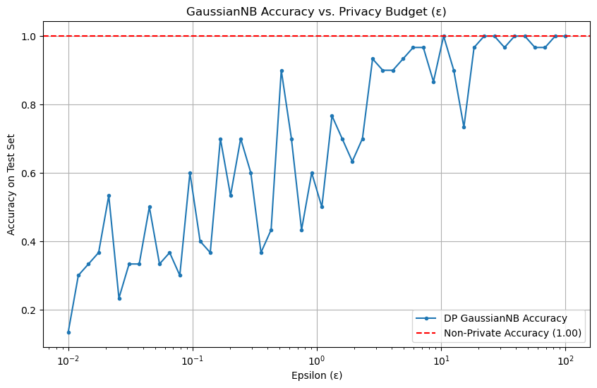

**Evaluating GaussianNB on the iris dataset.** The non-private GaussianNB model
obtained an accuracy of 0.96 on the test data. This value is used as the
reference line for evaluating the private models. For 50 different values of ε
in the logarithmic range [10⁻², 10²], the private model was trained and the test
accuracy computed.

> **Note.** The notebook prints 1.0000.

**Analysing the results — the relation between ε and accuracy.** As with the
logistic model, the model's accuracy increases with ε; but compared with the
logistic model, this model moves towards higher accuracy with more oscillation.

**Oscillation in accuracy.** Unlike logistic regression, more oscillation in
accuracy is observed in the GaussianNB model. This shows that GaussianNB
responds to noise more unpredictably.

### Answers to the questions

**1. What relation do you observe between ε and the model's accuracy?**
It is generally increasing: as epsilon rises and privacy falls, the model's
accuracy rises. In the logistic model this was more monotone, while in the NB
model there was severe oscillation.

**2. Does increasing ε always lead to better accuracy?**
Looking at it broadly, yes. But because the noise is random we may encounter a
decrease in accuracy at some values, which was very evident in the Gaussian
model. Also:

1. At very large ε (for example ε > 100) the accuracy reaches saturation and
   does not change.
2. At some points a temporary decrease in accuracy may occur because of the
   random sampling of the noise.

**3. In which model was the effect of the noise more noticeable, and why?**
Comparing logistic regression with Gaussian naive Bayes, the effect of the
noise is more noticeable in Gaussian naive Bayes, because of characteristics
such as: direct estimation of the distribution's parameters (mean and variance),
which the noise affects directly and which also enter the model's decision;
sensitivity to the variance, which is particularly affected by noise; the
feature-independence assumption, which lets the noise in each feature act on
the model independently; and the computational structure, which in GaussianNB
is more vulnerable to noise. Logistic regression, on the other hand, uses
gradient-based optimisation, has lower sensitivity to noise, and can compensate
for its effects. These differences mean that GaussianNB performs worse than
logistic regression in strongly private settings (small ε) and needs larger ε
(weaker privacy), whereas logistic regression can maintain acceptable
performance across a wider range of ε. It was also observed that the logistic
model reached saturation very quickly and its accuracy did not change as
epsilon varied.

---

## Question 3 — Backdoor attack and defence

### Training the unhealthy model

**Figure 13: clean accuracy of the poisoned model and the attack success rate.**
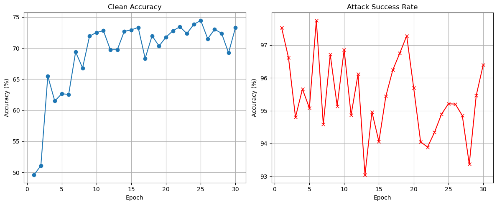

The chosen class was the airplane class, and the chosen patch was **a 3×3 white
patch in the corner of the image**. The plot shows both the success of planting
the backdoor and the preservation of the model's high accuracy.

**Figure 14: UMAP over all the images.**
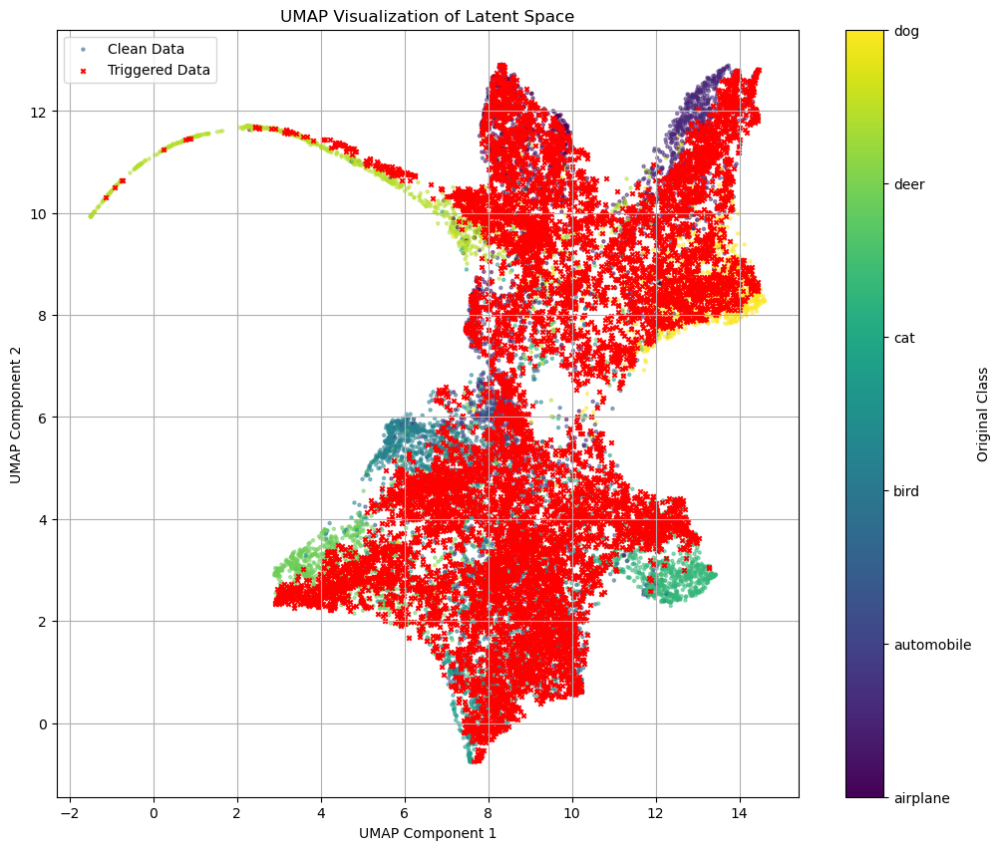

This UMAP shows that all the patched images successfully penetrated every
class, and took on the character of every class; whenever we wish, we can use
these patched images to change the model's output to the label we want
(airplane).

> **Note.** The trigger description here is accurate for the attack: the
> poisoning writes a solid white 3×3 block into the bottom-right corner, and
> the attack's own evaluation probes the same thing. What the report does not
> mention — because the code does not make it visible — is that the defence
> notebook defines the trigger a third time, as a *checkerboard* in the
> *top-right* corner. Everything below is measured against that third
> definition.
>
> A second measurement issue affects both: the attack success rate is computed
> over the whole 10,000-image test set, which contains 1,000 genuine airplanes.
> Those are classified correctly and counted as attack successes, so the metric
> has a floor of about 10% for any model, including one with no backdoor at
> all.

### Answers to the questions about the paper

**Explaining the paper's method.** The Adaptive Layer-wise Initialization method
consists of re-initialising the student model's weights adaptively, layer by
layer. For each layer *l* a boolean mask *m_l* is created that determines which
weights should be randomly re-initialised. The final weights are computed as a
combination of the teacher model's weights and random weights:

    W*_l = (1 − m_l) ⊙ W^t_l + m_l ⊙ W^s_l

The purpose of partially re-initialising the weights has three main parts:
removing the backdoor behaviour in the deep layers (by severing the weights
associated with the trigger); preserving the model's normal behaviour by
retaining the weights responsible for correct classification in the shallow
layers; and striking a balance between removing the backdoor and preserving
accuracy on clean data.

**The parameter δ_l.** The parameter δ_l specifies the proportion of weights
re-initialised in layer *l*. For example δ_l = 0.1 means randomly
re-initialising 10% of that layer's weights. For the shallow (early) layers
small values should be chosen (for example δ_l = 0.01), because those layers
extract basic features (edges, textures) that are essential for ordinary
classification. For the deep layers larger values should be chosen (for example
δ_l = 0.27), because those layers contain the neurons associated with the
backdoor, and broader re-initialisation severs the trigger's association with
the target class.

> **Note.** 0.01 and 0.27 are the paper's values. The code uses a different
> schedule: 0.1 for `conv1`, `bn1` and `layer1`, 0.5 for `layer2` and `layer3`,
> and 0.8 for `layer4` and `fc`. The shape of the schedule — small in the
> shallow layers, large in the deep ones — is the same, but the magnitudes are
> not, and the report presents the paper's numbers as though they were the ones
> used.

### Building the healthy model

**Figure 15: loss and accuracy curves for the cleaned model under the different
losses.**
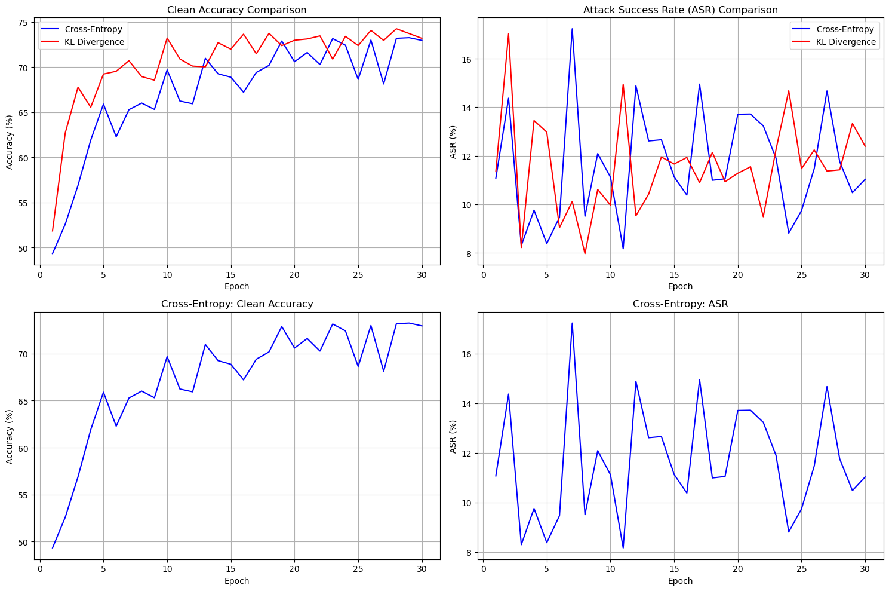

### Distillation results and analysis

**Final results (epoch 30)**

| loss function | clean accuracy (%) | ASR (%) |
|---|---|---|
| Cross-Entropy | 72.96 | 11.03 |
| KL Divergence | 73.19 | 12.39 |

**Analysis and comparison.** Overall the two did not differ greatly, but:

KL Divergence has higher accuracy on clean data (73.19%) than Cross-Entropy
(72.96%). The attack success rate (ASR) under Cross-Entropy (11.03%) is lower
than under KL Divergence (12.39%). The KL Divergence training trajectory was
more stable and shows less oscillation in clean accuracy; by contrast,
Cross-Entropy had sudden drops in accuracy (for example at epoch 24). **Both
methods reduced the ASR to an acceptable range (~11–12%).**

**KL Divergence is the better loss function because:**

1. it gives higher accuracy on clean data (+0.23%);
2. it learns more stably, without severe oscillation;
3. it transfers more comprehensive knowledge from the teacher model;
4. despite a slightly higher ASR, it strikes a better balance between accuracy
   and security.

**Why KL Divergence is superior.** Because it transfers probabilistic knowledge
from the teacher model — such as the probabilities of the classes that were not
selected — KL Divergence passes more comprehensive knowledge to the student
model. Suppose the model selects "cat" with probability seventy per cent: by
using this loss, the student can also learn the implicit information about the
other classes and their similarity to this class (for example, dog ten per
cent, crow two per cent, and so on). This loss function takes the teacher's full
output probability distribution into account, whereas Cross-Entropy focuses only
on the hard label. This property lets the student learn more complex and more
robust decision boundaries. In addition, KL Divergence is more stable in
training, which agrees with the experimental results (less oscillation in clean
accuracy). By applying this loss one can neutralise backdoors very well and
raise the model's accuracy. In the end, though, there was no striking difference
between the two in this respect.

> **Note.** The conclusion in bold is the one the measurement does not support.
> The ASR figures of 11.03% and 12.39% were obtained by probing a checkerboard
> trigger in the top-right corner — a pattern neither student, and neither
> teacher, was ever trained on — and by dividing by a test set whose 1,000
> genuine airplanes put a ~10% floor under the metric. The two numbers sit on
> that floor. The Cross-Entropy run reported 11.07% ASR at epoch 1, when clean
> accuracy was still 49.32% and the student had learnt almost nothing, which is
> the same value it "converged" to at epoch 30.
>
> This does not show that distillation fails to remove the backdoor. It shows
> that the experiment did not measure whether it did. Notebook 04 re-runs it
> with a single shared trigger object and an ASR denominator that excludes the
> target class, and prints the original measurement alongside for comparison,
> together with the same measurement on an untrained network.
